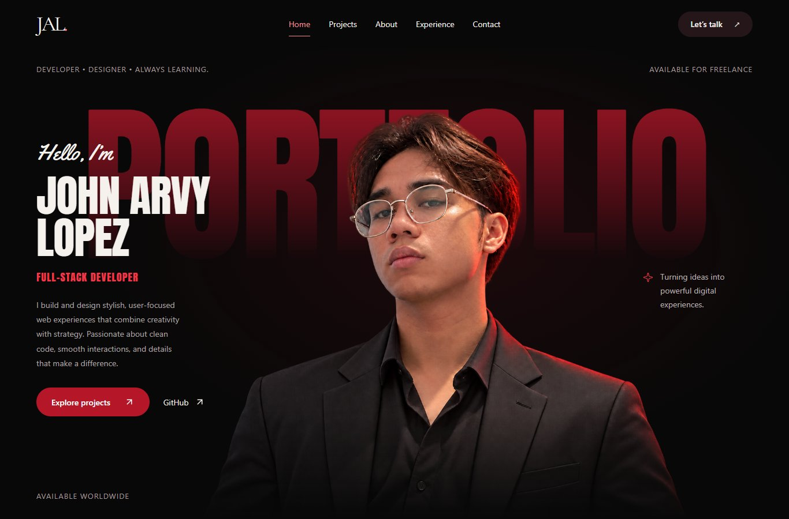

# John Arvy Lopez — Portfolio

A personal portfolio for a full-stack developer and fourth-year BS Information Technology student based in Iloilo, Philippines. Built with React and Vite, the site brings together application projects, design work, a college development roadmap, and ways to get in touch.

**[Visit the portfolio](https://johnarvylopez.vercel.app/)** · **[Explore the code](frontend/src)** · **[Contact John](mailto:Johnarveylopez0@gmail.com)**



## What is inside

- **Featured work:** project screenshots, technology tags, repository links, and individual case-study pages.
- **Project archive:** application and design categories, including BreedSmart Oton, Car-Pass, Plustech, PHINMA Event, E-Thrift, Virtual Space Offices, and MangaFlix.
- **About and capabilities:** a personal introduction, development approach, and expandable toolkit sections.
- **College roadmap:** the projects behind each year of the development journey.
- **Beyond the screen:** one Web Design Champion carousel containing the awarding, team, and collaboration photos. Previous/Next controls sit on the image; keyboard arrows, touch swipes, and a full-photo dialog are supported.
- **Contact:** a direct email link and a project enquiry form backed by a Vercel Function and Resend.
- **Responsive and accessible interactions:** mobile navigation, visible keyboard focus, accessible media dialogs, and reduced-motion support.

## Built with

| Layer | Tools |
| --- | --- |
| Interface | React 19, React Router 7, JavaScript / JSX |
| Build | Vite 7 |
| Styles | Custom CSS, shared design tokens, Tailwind CSS 4 integration |
| UI primitives | Radix Dialog and Slot, Lucide icons |
| Hosting | Vercel |
| Contact delivery | Vercel Function + Resend |

The reference palette combines black `#0B0B0B`, crimson `#8B0D1A`, and off-white `#F5F2ED`. The cinematic homepage uses self-hosted display fonts and a portrait composition; section styles and motion rules are shared across routes.

Portfolio content is stored in JavaScript. The site does not need a database, CMS, or AI service to run. The backend technologies mentioned in project case studies belong to those showcased applications.

## Run locally

Use Node.js **20.19 or newer, below 25** and npm. The application lives in `frontend/`.

```bash
git clone https://github.com/Khaos-s/Portfolio.git
cd Portfolio/frontend
npm ci
npm run dev
```

Open the local URL printed by Vite.

| Command, inside `frontend/` | Purpose |
| --- | --- |
| `npm run dev` | Start the development server |
| `npm run lint` | Check JavaScript and JSX with ESLint |
| `npm run build` | Create the production build in `dist/` |
| `npm run preview` | Preview the production frontend locally |

Vite serves the frontend only. It does not execute `api/contact.js`; use a Vercel environment to test the contact endpoint. The direct email link works independently of the form service.

## Project structure

```text
frontend/
  api/contact.js          Server-side contact validation and email delivery
  public/                 Public static files
  src/
    assets/               Project screenshots, photos, and local fonts
    components/
      layout/             Header, footer, page shell, and introduction
      projects/           Project cards, covers, and reel
      sections/           Hero, experience, gallery, capabilities, and contact
      ui/                 Shared Button and Dialog primitives
    content/portfolio.js  Profile, projects, roadmap, gallery, and achievements
    lib/                  SEO, reveal hook, and utilities
    pages/                Route-level pages
    styles/               Design tokens, hero styles, and motion rules
    index.css             Shared layouts and component styling
  vercel.json             SPA fallback and security response headers
docs/                     Content notes and homepage preview
```

## Routes

| URL | Page |
| --- | --- |
| `/` | Home, featured work, About, experience, and contact sections |
| `/projects` | Project archive |
| `/projects/:slug` | Individual project case study |
| `/resume` | About and professional profile |
| `/contact` | Contact page |

Home navigation also supports `/#home`, `/#work`, `/#about`, `/#experience`, and `/#contact`.

## Update the content

Edit [`frontend/src/content/portfolio.js`](frontend/src/content/portfolio.js) to update profile details, projects, skills, the college roadmap, or gallery photos. Add only confirmed descriptions, contribution details, outcomes, and links. Unknown project fields use `null` or empty arrays and are omitted from the public case study where applicable.

To add a carousel photo, import the image and append it to `experienceGallery.photos`:

```js
import anotherPhoto from '../assets/Awarding/another-photo.webp';

// Inside experienceGallery.photos:
{ image: anotherPhoto, alt: 'A description of the people and moment shown' },
```

The photo counter and Previous/Next navigation update with the array. Image captions share the **Web Design Champion** title. There are no category selection boxes below the carousel.

For a downloadable résumé, add a current public PDF at `frontend/public/resume.pdf` and an explicit link when ready; the existing `/resume` route is the About page.

## Contact service configuration

The public direct-inquiry address is **[Johnarveylopez0@gmail.com](mailto:Johnarveylopez0@gmail.com)**.

The form posts to `/api/contact`, where the server validates the fields and sends plain-text email through Resend. Configure these variables in the intended Vercel environment:

| Variable | Purpose |
| --- | --- |
| `RESEND_API_KEY` | Resend API credential |
| `CONTACT_TO_EMAIL` | Recipient inbox for form submissions |
| `CONTACT_FROM_EMAIL` | Sender identity configured with Resend |
| `SITE_URL` | Optional exact allowed browser origin |

[`frontend/.env.example`](frontend/.env.example) contains safe placeholders. Keep actual credentials out of Git and do not prefix server-only values with `VITE_`.

The form includes required-field checks, length limits, a honeypot, duplicate-submission protection, a client timeout, and draft preservation on failure. Durable rate limiting is a remaining improvement for public traffic. Publishing the direct email address does not configure the form's recipient or email credentials.

## Deploy to Vercel

The repository's existing Vercel Git integration deploys pushes to `main`. For a fresh import, use:

| Setting | Value |
| --- | --- |
| Root Directory | `frontend` |
| Framework | Vite |
| Install command | `npm ci` |
| Build command | `npm run build` |
| Output directory | `dist` |
| Node.js | 24.x, compatible with the package's declared range |

Before releasing, run lint and build, check desktop/mobile navigation, verify direct-route refreshes, and exercise the image carousel. Email delivery needs separate verification in an environment with the server credentials configured.

## Further documentation

- [Application architecture](frontend/ARCHITECTURE.md)
- [Frontend development notes](frontend/README.md)
- [College roadmap and gallery content](docs/EXPERIENCE_ROADMAP.md)
- [Project screenshot notes](docs/PROJECT_SCREENSHOTS.md)

Local font licenses are included with their corresponding font assets.
